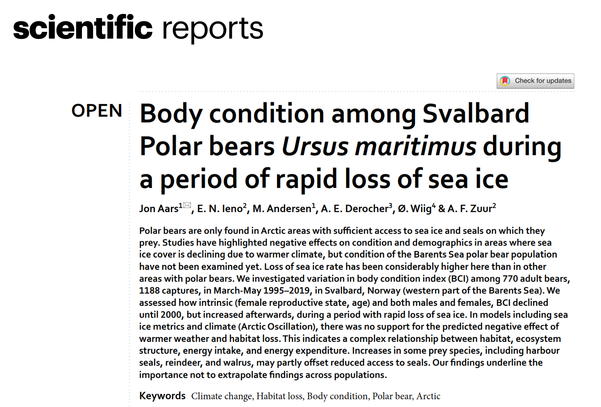

```{r}
#| label: setup
#| include: false
knitr::opts_chunk$set(
  fig.align = "center",
  fig.width = 6,
  fig.height = 4
)

```

# Introduction

This exercise is based on the data from @Aars2026.



::: callout-tip
Read the abstract and the methods section of the paper, so that you can understand what the different columns are. The paper is freely available here <https://www.nature.com/articles/s41598-025-33227-9> and also provided in moodle.
:::

# The paper and its methods

Describe in your own words what the data is about, what were the statistical methods used for analysis. In particular, describe what is the main response variable and what are the main predictors the authors expect to explain the response

Dados: 1118 capturas de 770 ursos-polares adultos em Svalbard, Noruega , entre março-maio de 1995-2019 (alguns indivíduos foram observados mais que uma vez

incialmente eram 1300

Métodos estatísticos usado para análise:

Variável de resposta: Indíce de massa corporal (BCI)

# Read the data

Here you should read the data in

```{r}
bears <- read.csv("dataset_BCI_Aars2026.csv")
#this assumes that the dataset is in the same folder as the .qmd report
head(bears)
```

Ver os nomes das colunas

```{r}
names(bears)
```

e que tipo de dados tenho?

```{r}
str(bears)
```

Just to check, confirm how many records and how many columns (variables you have).

```{r}
dim(bears)
nrow(bears)
ncol(bears)
```

why is it that we have 'r nrow(bears)' records but the abstract refers to 1118

check: might be the records from 1995?

```{r}
sum(bears$Year==1992 | bears$Year==1993 | bears$Year==1994)
sum(bears$Long[!is.na(bears$Long)]<0 | bears$Long[!is.na(bears$Long)] > 35)

```

Ou seja, são 1300, menos 62 (de anos antigos) e 49 de zonas distintas e 1 que não sabemos de onde veio.

Ou seja, são 1300, menos `r sum(bears$Year==1992 | bears$Year==1993 | bears$Year==1994)` (de anos antigos) e `r sum(bears$Long[!is.na(bears$Long)]<0 | bears$Long[!is.na(bears$Long)] > 35)` de zonas distintas e `r sum(is.na(bears$Lat))` que não sabemos de onde veio. `r  7*10` `7*10`

# Exploratory data analysis

Provide an exhaustive exploratory data analysis, describing in your own words the main patterns found.

```{r}
#possible example plots
with(bears,hist(BCI,xlab="Indice de massa corporal",main="",col="cyan"))

```

Como varia o BCI com o sexo:

(variavel quantiativa em funcao de uma categorica)

```{r}
with(bears, boxplot(BCI~Sex,xlab="Sex",main="",col="cyan"))

```

Focando nas fêmeas:

```{r}
with(bears, boxplot(BCI~withCubs,xlab="withCubs",main="",col="cyan",names=c("COY","Sem crias", "Crias 2 anos","Crias 1 ano")))
#ver o que é cada letra
```

Focando nas femeas com COYs (cub of the year)

```{r}
with(bears[bears$withCubs=="c",], boxplot(BCI~nCubs,xlab="quantidade de crias",main="",col="cyan",))

```

será que o dia em que foi capturada tem influências na BCI, dado que tem crias com menos de um ano

```{r}
with(bears[bears$withCubs=="c",], plot(BCI~DayM,xlab="Days since 1st of March",main="",ylab="BCI",))
abline(lm(BCI~DayM,data=bears[bears$withCubs=="c",]))

#OR
#select females with cubs of the year
bearsFc <- bears[bears$withCubs=="c",]

with(bearsFc, plot(BCI~DayM,xlab="Days since 1st of March",main="",ylab="BCI",))

#adicionar uma reta dos minimos quadrados
#ajustar uma reta
#lm é modelo linear
lm1 <- lm(BCI~DayM,data=bearsFc)
#coloco a reta no plot
abline(lm1)

```

Se tanto, haverá um pequeno aumento na minha massa corporal à medida que o tempo passa desde que saímos da toca.

Relacionar o BCI com o gelo do ano anterior

```{r}
par(mfrow=c(1,2))
with(bearsFc, plot(BCI~IceFreeDaysLag1,xlab="Ice Free Days (lag 1)",main="",ylab="BCI",))
with(bearsFc, plot(BCI~IceFreeDaysLag2,xlab="Ice Free Days (lag 2)",main="",ylab="BCI",))


```

```{r}
for (i in 8:18){plot(bears$BCI~bears[,i],xlab=names(bears)[i],main="",ylab="BCI")}
```

# Sampling

Pretend that the dataset is the entire population of bears that you want to sample from.

## Simple random sampling

Estimate, based on random samples of size 5, 10, .... 100 what is the mean body condition for polar bears around Svalbard.

```{r}
#tamanhos da amostra
ns <-seq(from=5,to=100,by=5)
#quantos são os tamanhos de amostra
nns <- length(ns)
nns
#mean value of BCI - an estimate
mBCI <- numeric(length=nns)
mBCI

#se eu quisesse garantir q tinha sempre o mesmo resultado: set.seed(123)
for(i in 1:nns){mBCI[i] <- mean(sample(x=bears$BCI,size=ns[i],replace=FALSE))}
mBCI

```

Create a plot where you have sample size on the x axis, and the mean estimate on the y axis. Add an horizontal dashed blue line of width 3 with the population mean (i.e. the mean for all bears)

```{r}
plot(ns,mBCI)
abline(h=mean(bears$BCI),lty=2,col="blue",lwd=3)
```

In your own words, what happens as the sample size increases?

## Stratified random sampling

Next, repeat the procedure treating each sex as a stratum. Do a separate plot for each sex and then contrast with a single plot with all bears.

```{r}
#Females first

#mean value of BCI - an estimate
mBCIf <- numeric(length=nns)
mBCIf

#se eu quisesse garantir q tinha sempre o mesmo resultado: set.seed(123)
for(i in 1:nns){mBCIf[i] <- mean(sample(x=bears$BCI[bears$Sex=="f"],size=ns[i],replace=FALSE))}
mBCIf

#Males

#mean value of BCI - an estimate
mBCIm <- numeric(length=nns)
mBCIm

#se eu quisesse garantir q tinha sempre o mesmo resultado: set.seed(123)
for(i in 1:nns){mBCIm[i] <- mean(sample(x=bears$BCI[bears$Sex=="m"],size=ns[i],replace=FALSE))}
mBCIm
```

and now plot

```{r}
par(mfrow=c(1,2))
plot(ns,mBCIf)
abline(h=mean(bears$BCI[bears$Sex=="f"]),lty=2,col="red",lwd=3)
plot(ns,mBCIm)
abline(h=mean(bears$BCI[bears$Sex=="m"]),lty=2,col="blue",lwd=3)
```

Compare the estimated mean by sex and the corresponding overall mean using the sex as strata vs not using the sex as strata.

```{r}
mean(bears$BCI)

mf <- mean(bears$BCI[bears$Sex=="f"])
mf
mm <- mean(bears$BCI[bears$Sex=="m"])
mm

(mm+mf)/2
#mas esta média nao tem em conta que ha mais femeas do q machos, portanto a seguir vamos fazer uma media ponderada


#numero de machos
mn <- sum(bears$Sex=="m")
mn

#numero de femeas
nf <-  sum(bears$Sex=="f")
nf

#media ponderada
(mm*mn+mf*nf)/(mn+nf)
```

Compute: The overall mean The mean for females the mean for males the overall mean using the strata means

## Systematic sample

In random sampling you can get very unbalanced samples (over space, over time, etc). Here consider using a systematic sample to select records with the best possible temporal coverage. Select a systematic sample of size 90.

```{r}

```

How does it compare with the overall mean? Discuss

## Years as strata

Treating the year as strata, check how many bears you have per strata, and then estimate the mean BCI per year, and then an overall BCI, comparing the two estimates

```{r}

```

Plot BCI over time

```{r}

```

Separate this plot for males and females. First separate data by males and females

```{r}

```

```{r}

```

What is the correlation between these two time series? (tip: the function `cor` calculates correlation between two time series)

```{r}

```

# What is, really, our population

Check out how many records you have, and how individual bears you have. What does that mean? (tip: function `unique` might come in handy)

```{r}

```

# Independent work for extra points!

If you complete this task, send the complete .qmd and the corresponding .docx (=Word file) to tamarques\@ciencias.ulisboa.pt

Can you find a way to add the data in these two plots in the same plot, using a plot with two y axis? Check out example here <https://r-graph-gallery.com/145-two-different-y-axis-on-the-same-plot.html>

Explore the contents in <https://www.data-to-viz.com/caveats.html> regarding things you should consider carefully when using plots

# References
