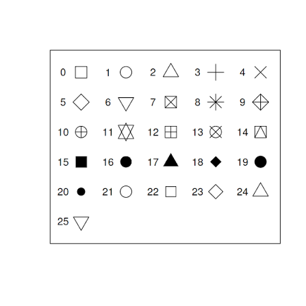

```{r,warning=FALSE,message=FALSE}
# DO NOT TOUCH THIS CODE
#| label: setup
#| include: false
knitr::opts_chunk$set(
  fig.align = "center",
  fig.width = 6,
  fig.height = 4
)
library(knitr)
```

# Important messages

Before event starying, check this .qmd compiles. Render it to .html and . docx. It should work.

For this to compile you have to have in the same folder the:

1.  `Week7Data00000.qmd` - the quarto dynamic report itself

2.  `biblio.bib` - the `.bib` file that contains the references to cite

3.  `mee.csl` - this is a file that formats references using the style for the journal Methods in Ecology and Evolution

4.  `pch_in_R.png` - an image to be included in the report (see details below)

# Introduction

In this week the plan is for you to get used to work with different datasets. A useful read to help guide your data exploration is @Zuur2009. Another source of helpful general guidance regarding Ecologia Numérica, or broadly Statistical Ecology, is @Popovic2024.

You will use 5 (sets of) datasets, one dataset (or sets of datasets) from each of your practicals teachers, namely:

- for TAM: `obs_data` and `seg_data`; data used in @Martins2026; You are only receiving part of the massive 1.9 Gb dataset. Check here for the full data if you like to see it all <https://zenodo.org/records/18711398>

- for ASR: `coleopteros.csv`, `pseudoescorpioes.csv` and `ligiaoceanica.csv`; o documento `ASR Ficha de trabalho de Ecologia Numérica 2026.pdf` descreve o contexto ecológico. Não sendo trabalhado em aula, será ainda adicionado um conjunto de dados associado a uma publicação que poderá ser trabalhado de forma independente.

- for SF: `Species richness_fishes_estuaries.xlsx`; dados usados em @Franca2012

- for RL: `soon to be added`

- for HR: `soon to be added` Não sendo trabalhado em aula, será ainda adicionado um conjunto de dados associado a uma publicação que poderá ser trabalhado de forma independente.

and with those you will:

1.  read it in
2.  explore/understand what the data is about
3.  identify possible response variables vs. explanatory variables
4.  do some data manipulation
5.  do some data exploration
    - summary statistics
    - data visualizations
6.  based on all your findings, report about what you learned from these different ecological settings

# An example tip

Just to help you out, here are the different values for plotting symbols in R. This is also an example on how to include an external image in a Quarto dynamic report! (try to include at least one additional image yourself)



You are challenged to to add your own tips and tricks to this document, making it a much more useful study document. Remember, ultimately that is what these documents should be, much more that something you submit in moodle.

# Dataset worked in class

::: callout-tip
Read the material provided for context, so that you can understand what the different columns are.
:::

## The paper and its methods

::: callout-tip
Describe in your own words what the data is about.
:::

## Read the data

::: callout-tip
Here you should read the data in
:::

```{r}
#quando eu der import do dataset, vou a consola e copio aquela parte q esta aqui em baixo para eu ler os dados aqui no documento
obs_data<- read.csv("obs_data.csv")
```

These are the names of the variables

```{r}
names(obs_data)
```

to know what these columns are, i could check on the online data repository zenodo <https://zenodo.org/records/18711398>

::: callout-tip
Just to check, confirm how many records and how many columns (variables you have).
:::

```{r}
# replace the NA with an expression that corresponds to the correct value
# how many rows
nr <- nrow((obs_data))
# how many columns
nc <- ncol(obs_data)
```

We have `r nr` rows and `r nc` columns.

## Exploratory data analysis

::: callout-tip
Provide an exhaustive exploratory data analysis. Use both location and dispersion summary statistics, and also extensive data visualization to explore the data. Manipulate and modify data. Calculate summary statistics of a (response) variable for the different levels of a given (exploratory) variable.
:::

Key variables in the data include:

*`object` - a sighting ID      
*`distbegin` - lower bound of the distance bin associated with the detection     
*`distend` - upper bound of the distance bin associated with the detection     
*`lat` - latitude
*`lon` - longitude
*`x` - easting (projected latitude)
*`y`  - northing (projected longitude)
*`size` - group size
*`Sample.Label` - the segment the detection occurred at (allows to link to seg_data)
*`Seastate` - sea state (Beaufort scale)
*`Visibility` - measure of visibility (A = <2 km; B = 2 – 5 km; C = 6 – 9 km; D = >10 km)
*`Day` - day of the sighting
*`Month`  - month of the sighting
*`Year` - year of the sighting
*`ID` - an identifier of the sighting (this actually repeats "object"!)


Como posso saber quais os valores dos limites das classes de distância consideradas:
```{r}
unique(obs_data$distbegin)
#ou
with(obs_data,unique(distend))
```

Vamos agora calcular o valor médio do intervalo em que cada observação se encontrava

```{r}
#dm é distância média
obs_data$dm <- (obs_data$distbegin + obs_data$distend)/2
unique(obs_data$dm)

```

Assumindo que as distâncias médias dos extremos da classe de distância são uma boa aproximação do que era a distância real, a distância média global é `r round(mean(obs_data$dm),2)`


Vamos ver quantas distâncias temos em cada classe:
```{r}
table(obs_data$dm)
#ou
knitr::kable(table(obs_data$dm),col.names=c("Distancia","Frequencia"))

```


Vamos ver esta informação do ponto de vista gráfico
```{r}
hist(obs_data$dm, main="Histograma das distâncias",breaks=c(0,50,100,200,300))

barplot(table(obs_data$dm),ylab="Número de observações",xlab="Distância (m)")
```


Como a distância média varia em função do grupo, do seastate e da visibilidade:

Como varia a distância em função do seastate:
```{r}
#boa representação grafica para isto (fatores) - boxplot
with(obs_data,boxplot(dm~Seastate))
```

Interessante o facto de como o pior estado do mar parece ter distâncias maiores...
```{r}
obs_data[obs_data$Seastate==6,]
```

```{r}
table(obs_data$Seastate)
```

Se eu quiser saber o valor médio da distância por cada classe de estado do mar:
```{r}
dm.by.seastate <- tapply(X=obs_data$dm, INDEX = obs_data$Seastate, FUN=mean)
```

Representar isto de cima num gráfico:
```{r}
par(mfrow=c(2,2))
unique(obs_data$Seastate)
plot(sort(unique(obs_data$Seastate)),dm.by.seastate, type="p",ylim=c(0,150))
#o type quer dizer p->point l->line e b->both
plot(sort(unique(obs_data$Seastate)),dm.by.seastate, type="l",ylim=c(0,150))
plot(sort(unique(obs_data$Seastate)),dm.by.seastate, type="b",ylim=c(0,150))
plot(sort(unique(obs_data$Seastate)),dm.by.seastate, type="n",ylim=c(0,600),xlab="",ylab="", xaxt="n",yaxt="n")
#type n nao aparece lá nada
text(3,200,"banana")
```

```{r}
dm.by.vis <- tapply(X=obs_data$dm, INDEX = obs_data$Visibility, FUN=mean)

par(mfrow=c(1,1))
plot(1:4,dm.by.vis, type="p",ylim=c(0,150),xaxt="n",xlab="Visibility")
#adicionamos o eixo à mao:
axis(side=1, at=1:4, labels=c("A","B","C","D"))

```

Vamos agora ver um gráfico do tamanho do grupo no espaço @fig-fig1:

```{r}
#| label: fig-fig1
#| fig-cap: "Distribuição no espaço"
#| fig-width: 6
#| fig-height: 10
#vou por um label na figura e consigo me referir a figura em todo o documento; nao posso por um comentario acima destes labels, nao acima dos # q estao aí
with(obs_data,plot(lon,lat,cex=log(size)))

```

```{r}
#| label: fig-fig2
#| fig-cap: "Distribuição no espaço"
#| fig-width: 6
#| fig-height: 10

#ou podemos fazer de outras formas:
with(obs_data,plot(lon,lat,cex=size/100))
```

```{r}
#| label: fig-fig3
#| fig-cap: "Distribuição no espaço, tamanho proporcional ao sexo"
#| fig-width: 6
#| fig-height: 10

with(obs_data,plot(lon,lat,cex=size/100, xlab="Longitude",ylab="Latitude"))
legend("topleft",inset=0.05,title="Group size",legend=c(1,5,10,50,200),pch=1,pt.cex=c(1,5,10,50,200)/100)
legend("bottomleft",legend="Lanche", inset=0.1,pch=1,col="blue")

```

Como variou a distribuiçao de observaçoes no tempo
```{r}
barplot(table(obs_data$Year))
```


Olhando para o esforço:
```{r}
#| fig-width: 6
#| fig-height: 10

seg_data <- read.csv("seg_data.csv")
with(seg_data,plot(lon,lat))
with(obs_data,points(lon,lat,col="red",pch=19))
```


## Final challenges

- Describe in your own words the main patterns found and their corresponding ecological relevance
- do additional data manipulation

# Other datasets

Repeat the above process for additional datasets, or, even better, for all five datasets (creating one section for each dataset with the same structure of the material for the dataset you did in class).

This would be an endless task, as you could find new datasets to explore. You must practice R as much as possible, with as many datasets as possible.

If you complete this "Other datasets" task, submit the complete `.qmd` and the corresponding `.docx` (=Word file) in moodle [here](https://moodle.ciencias.ulisboa.pt/mod/assign/view.php?id=341925). You can submit work till the end of the semester.

Remember, this is your way of studying, and getting credit for it!

# References